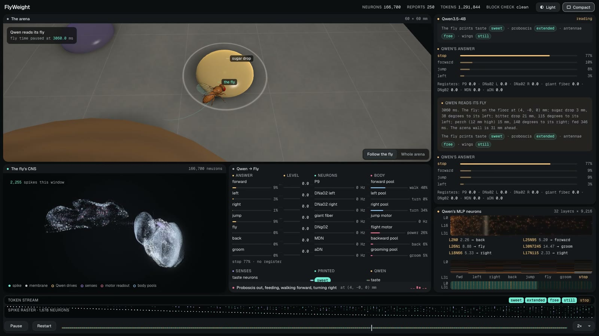

# FlyWeight

**A fruit fly's whole central nervous system compiled into Qwen3.5-4B's own layers.** The fly and Qwen
share a single residual stream and token stream. Qwen reads a report of its fly, its answer drives the
fly's descending neurons, and the fly's 166,700 spiking neurons move a simulated body and print what
they sense back into the text Qwen reads.



Each neuron is a vocabulary token, a spike is a greedy token and a 0.1 ms time step is a `TICK` token.
The fly's dynamics are three stock Qwen3.5 Gated DeltaNet layers after Qwen's 32, with weights computed
from the connectome rather than trained. The connectome is Janelia's male CNS v1.0 (brain and ventral
nerve cord) in Shiu et al. 2024's leaky integrate-and-fire model.

## What it does

Every 20 ms of fly time, one loop runs through the model:

<picture>
  <source media="(prefers-color-scheme: dark)" srcset="docs/images/loop-dark.svg">
  
</picture>

1. **The world writes a report**: where the fly is, the distance and bearing of the sugar drop, the
   bitter drop and the perch, how long it has fed and, on the floor, the distance to the wall ahead.
2. **The fly prints its senses.** A `SAY` token runs through the fly's layers and the greedy next token
   is a real word, chosen by the fly's own neurons: taste " sweet", " bitter" or " nothing"; proboscis
   " extended" or " folded"; antennae " touching" or " free"; wings " beating" or " still".
3. **Qwen's answer drives the fly.** At the report's last token, the fly's first layer reads Qwen's
   logits for its move words and writes them as drive on the descending neurons that command each
   behaviour: forward (P9), left and right (DNa02), back (the moonwalker neurons), jump (the giant
   fiber), fly (DNg02) and groom (the antennal grooming neuron).
4. **The fly's neurons run**: 200 time steps of the whole connectome, spike by spike, in the same model.
5. **The body moves.** Nerve-cord motor pools, read off the LM head, walk, turn, back up, groom, jump
   and fly a simulated fly in a 60 x 60 mm arena.

A visitor can type to Qwen, drive the command neurons directly, stimulate the senses or dust the
antennae, and watch every step in the browser.

## Quick start

One CUDA GPU with 24 GB (16 GB for the fly alone); Python 3.13, PyTorch 2.14 and Transformers 5.20.
Tested on an RTX 4090 and an H100.

```bash
pip install torch --index-url https://download.pytorch.org/whl/cu126   # or the build for your CUDA
pip install -e ".[checks,fast]"
bash scripts/setup/fetch_data.sh
```

`fetch_data.sh` downloads the male CNS connectome (~1.1 GB), the FlyWire annotations, Shiu et al.'s
model and Qwen3.5-4B. The first build caches the connectome as `external/male-cns/malecns-neurons.npz`.

**Watch it live.**

```bash
python scripts/run/serve.py --port 8770
```

Open http://localhost:8770 (on a remote GPU, forward the port with `ssh -L 8770:localhost:8770`). The
page shows the arena, the fly's CNS, Qwen's neurons and the bridge between them as the model runs. Type
anything to Qwen: your words go into every report until you clear them. Qwen's instructions never
mention a visitor and Qwen writes no reply, so your words reach the fly only through Qwen's move
logits. `--fly-only` runs the fly's layers alone, `--memory N` gives Qwen its last N reports and
answers, and `--adapt` runs the adaptation variant. One 20 ms window takes ~1.4 s on an H100.

**Record a session and replay it.**

```bash
python scripts/run/qwenfly_session.py --out results/qwenfly.pt --max-ms 6000
python scripts/run/export_viz.py results/qwenfly.pt viz
python -m http.server 8000 -d viz        # then open http://localhost:8000/?replay
```

`viz/` ships with a recorded session, so the replay works without a GPU. `?replay&flytime` plays it in
fly time alone, `?theme=light` or `?theme=dark` sets the theme, and Compact fits every panel on one
screen.

**Run the checks.**

```bash
python -m pytest                              # CPU unit tests
python scripts/checks/check_wiring.py         # CPU: every weight read back against its source
python scripts/checks/check_merged.py         # GPU: the fast path vs every layer on every token
```

Each check's pass criterion is in [docs/design.md](docs/design.md#checks-and-pass-criteria).

## Repository layout

```
flyweight/            the package
  merged.py           the one-stack model, its runner, the answer bridge and the printed-word rows
  fly_layers.py       the fly's three layers, their weights, the adaptation variant, CUDA-graph stepping
  setup.py            the standard model, built the same way by every script
  report.py           Qwen's instructions, worked examples and the report format
  flyworld.py         the body and the world; bodyint.py is the same body in integer arithmetic
  sets.py             the neuron sets and the operating point
  lif.py              an exact float64 executor of Shiu's model, the reference for the fly's layers
  connectome.py       Shiu's constants; malecns.py and annot.py load the male CNS and FlyWire annotations
  sparse.py           sparse weight storage behind the stock module interface
  checkpoint.py       the model as safetensors, a config and sha256 hashes, and its loader
  live.py             the live model loop; viewdata.py packs what the viewer shows
scripts/
  setup/              fetch_data.sh (the data) and pack_flybody.py (the viewer's fly mesh)
  calibrate/          how data/ was made: the control bridge's neurons, the body's readout, the answer map
  run/                serve.py (live), qwenfly_session.py (a recorded session), export_viz.py (for ?replay)
  checks/             pass/fail checks, each one's criterion in docs/design.md
  experiments/        controlled trials, text benchmarks, Shiu et al.'s figures, the connectome alone
data/                 derived inputs the model is built from: the body's readout, the answer map, the
                      control bridge's neurons
viz/                  the browser viewer (index.html), the fly's mesh and neuron positions, a recorded session
tests/                CPU unit tests
docs/                 design.md (the design and every check's criterion), related.md (related work,
                      open directions), figures/ (this page's diagrams as Mermaid, rendered with pele)
```

Scripts write their outputs to `results/` and the checkpoint to `checkpoint/` (both ignored by git).
`node docs/figures/render.mjs`, after `npm install pele`, redraws the figures.

## How it works

### One stack

<picture>
  <source media="(prefers-color-scheme: dark)" srcset="docs/images/stack-dark.svg">
  
</picture>

- `QwenFlyModel` (`flyweight/merged.py`) is Qwen3.5-4B's 32 decoder layers followed by the fly's 3
  (`flyweight/fly_layers.py`), all stock `Qwen3_5DecoderLayer` modules sharing one residual of
  6 x 4^9 = 1,572,864 dims, one vocabulary (248,320 text tokens + 166,870 fly tokens), one cache and one
  token stream. Qwen's weights are unchanged (dense bf16 blocks); the fly's are sparse.
- **Isolation by weights.** On a fly token, mute columns on the fly's ballast set Qwen's DeltaNet decay
  to 1, its write to 0, its output to 0 and its attention output gate to 0. On a text token the fly
  writes nothing and is never decoded. Qwen's full attention ignores fly positions through the
  attention mask.
- **The fly's layers.** Layer 1 holds the drive registers. Layer 2 is a 23-slot spike ring whose
  19-slot-back read passes through the connectome (the 1.8 ms synaptic delay); its MLP adds synaptic
  and tonic input unless refractory. Layer 3 holds every membrane and the motor readout. Spike logits
  are membrane potentials, so greedy decoding is the spike threshold.
- **Fast path.** Qwen's layers are skipped on fly tokens and run on the 2,569 dims a text token holds
  (their norms still divide by the whole width); the fly's layers run only on a report's last token;
  on fly tokens the LM head computes only the fly's and the printed words' rows, each residual norm
  is its own two products (the ballast makes the divisor exactly 2^24) and all-zero products are
  skipped. The fly's steps replay as CUDA graphs. The full forward runs all 35 layers on every token
  over the whole residual, and `check_merged` compares the two.

The connectome is the male CNS v1.0 (166,700 neurons) with Kenyon-cell-to-Kenyon-cell synapses removed
and synapse counts scaled by 0.73 (without both, the network ignites), plus the giant fiber's
electrical junctions onto the jump motor neurons and PSI. Electron microscopy does not see gap
junctions, and without them the giant fiber cannot make the fly jump.

### One window

A 20 ms window is a stretch of the token stream: the report's text with the fly's printed words in it,
the report's last token, where Qwen's answer sets the drive, then 200 steps of spike tokens.

<picture>
  <source media="(prefers-color-scheme: dark)" srcset="docs/images/window-dark.svg">
  
</picture>

### The answer bridge

<picture>
  <source media="(prefers-color-scheme: dark)" srcset="docs/images/bridge-dark.svg">
  
</picture>

At the report's last token (`"):"`) the fly's first layer reads Qwen's final hidden state through Qwen's
own final norm and projects it on Qwen's unembedding rows: s_w, Qwen's logit of each move word over a
reference word. The steering pair inhibit each other, so at most one side turns, by Qwen's margin for
it. Both inhibit forward, so a strong pull to one side stops the walk and the fly turns in place. Groom
inhibits every walking word, so a fly pulled toward grooming stands and grooms. Back, jump and fly are
read against forward rather than stop. The references, offsets and slopes are fitted to a hand-written
pilot's levels over the synthetic reports where Qwen's own move is the pilot's
(`scripts/calibrate/check_answers.py`); fitting only where they agree keeps the map from reversing
Qwen's other choices. Slopes are powers of two, so `DRIVE` tokens (a visitor's drive, the hand-written
pilot in the trials) write the same registers exactly. The report's last token clears the registers
before Qwen's answer writes them. Each report is read from a saved post-instructions state of Qwen's
layers, and the instructions hold 28 worked reports.

A control bridge reads six groups of 8 of Qwen's MLP neurons through extra down-projection rows and a
hand-written map. Their direct effect on Qwen's move logits mostly favours other words: they mark
where the target is and what state the fly is in more than which move to make.

### Printed senses

After the host writes " Its neurons: taste", ", proboscis", ", antennae" and ", wings", a `SAY` token
runs through the fly's layers and the greedy next token is the fly's word. LM-head rows add 2^16 at
their own slot plus 1/8 per Hz of the fly's taste neurons, MN9, Johnston's organ or flight power motor
neurons above a threshold.

### The neurons

Chosen by Janelia's cell types and checked in the connectome (`scripts/checks/check_wiring.py`): P9
(DNp09) for forward; DNa02 for steering, 92% of whose synapses are on its own side; MDN for backward
walking, 67% of whose output goes to nerve-cord interneurons; the antennal grooming descending neuron
(DNg12_e), 70% of whose output is in the front-leg neuromere; the giant fiber (DNp01), with 90 synapses
on the jump motor neurons; DNg02 for wing power. The senses are bilateral: sugar is FlyWire's labellar
type LB3c (23 neurons), which excites MN9 three synapses away; bitter is LB1a-d (38), which inhibits
it; Johnston's organ C/E is 335 neurons. The body reads nerve-cord pools that each command recruits
selectively in the fly's own layers, plus TTMn, DLMn/DVMn, b1/b2 and MN9, and never a driven neuron.
The table and the reasons are in [docs/design.md](docs/design.md#the-neurons-flyweightsetspy-flyweightflyworldpy).

### Body and world

Outside the neurons, as in NeuroMechFly or flybody (`flyweight/flyworld.py`). The world writes the
sense registers: taste neurons fire while the labellum is on a drop, and Johnston's organ fires while
the antennae meet the arena wall ahead or carry dust. The body moves from the MOVE rows: the forward,
turn and backward pools, the grooming pool (the fly stands while its front legs clean the dust off),
both jump motor neurons for takeoff, the flight power motor neurons and MN9 for feeding. In flight,
wing power sets the speed and the height the fly holds, the turn pools steer it, and near a wall it
turns away in a saccade. The connectome's left and right turn circuits are not mirror images: forward
drive also recruits the left-turn pool, so each turn pool has what forward drive alone recruits in it
subtracted at the forward pool's present rate. The viewer draws stepping and the wingbeat; the LIF
connectome has no rhythm generator. `flyweight/bodyint.py` is the same body in integer arithmetic, a
form a circuit of stock layers can compute exactly.

### Variants

- **Memory** (`--memory N`). Qwen reads each report after its own log of earlier reports and answers,
  kept in its cache, instead of from the post-instructions state; the log restarts from the
  instructions with its last N entries when it reaches 2N.
- **Adaptation** (`--adapt`). Shiu's model has no spike-frequency adaptation. The variant adds one
  layer-3 head per neuron: a threshold rise of 16 mV times the neuron's leaky refractory fraction
  (tau 200 ms), so a neuron firing at 100 Hz sits ~3.5 mV higher. Brian2 runs the same rule.

## Relation to QwenPU

FlyWeight's method for putting a second computation inside Qwen3.5 comes from
[QwenPU](https://github.com/divagr18/QwenPU) by Divyansh Agrawal, which compiles a RISC-V CPU and a
vector unit into stock Qwen3.5 layers in front of Qwen3.5-4B. FlyWeight reimplements its techniques
for a spiking connectome:

| technique | QwenPU (`chipformer/q35`) | FlyWeight |
|---|---|---|
| a second machine in stock Qwen3.5 layers, every weight computed | 13 layers before Qwen's 32: a RISC-V core and a vector unit | 3 layers after Qwen's 32: the connectome |
| widening the checkpoint | Qwen's matrices zero-padded; the full-residual norms' gains scaled by sqrt(D / D') | the same, to 1,572,864 dims |
| ballast | chip tokens carry B in m ballast dims; with m x B^2 / hidden a power of 4, every RMSNorm divides by an exact power of two | fly tokens carry 2^33 in 6 ballast dims; a hidden size of 6 x 4^9 makes the divisor exactly 2^24 |
| muting Qwen on foreign tokens | weights on a ballast dim set Qwen's DeltaNet decay to 1 and its write, output and attention output gate to 0 | the same |
| exact nonlinearity | SiLU used as an exact ReLU, with gate values at least 18 or at most -104 | the same (SiLU passes values above 17.3 unchanged) |
| state | Gated DeltaNet heads as exact memories with one-hot keys | the registers, the spike ring and the membranes in DeltaNet heads |
| clock | every token is the model's greedy prediction; the host injects TICKs and writes | spikes are greedy tokens; the host injects TICK, DRIVE and SAY tokens |
| output as text | the machine prints real text tokens that Qwen reads in the same stream | the fly prints its senses as real words |
| checking | in lockstep against a reference machine | step for step against a float64 executor and Brian2 |
| text benchmarks | `chipformer/q35/text_eval.py` | `scripts/experiments/text_eval.py` adapts its task loaders and scoring |

The differences follow from the machine. QwenPU's is digital and exact in integers; FlyWeight's is a
spiking network whose membrane potentials are fp32 and whose greedy decoding is the spike threshold.
QwenPU's layers sit in front of Qwen and see Qwen's text through classes carried on its embedding
rows; FlyWeight's sit after Qwen, so the fly's first layer reads Qwen's final hidden state at the
report's end in the same forward pass. FlyWeight stores the connectome's 24.9 million connections as
sparse weights behind the stock module interface, and adds a body and a world around the model.

## Results

Numbers are from an RTX 4090 unless marked H100.

### Exactness

| check | result |
|---|---|
| wiring audit, from the built weights (`check_wiring`) | every set and connectome check in docs/design.md; all 24,939,905 connections held once at the exact weight, the giant fiber's junctions included; every register, inhibition, MOVE row and printed word reads exactly its source; the answer bridge's 7 x 2,560 coefficients are Qwen's unembedding rows; the registers clear only at the report's end |
| the fly's layers vs an exact float64 executor, random 400-neuron connectome, 400 ms of random register schedules (`check_fly_layers`) | 493 spikes each, 0 of 4,000 steps differ; motor readout within 4.9e-4 Hz |
| the same, whole CNS, 300 ms, all 10 registers | 60,590 and 60,592 spikes; the first difference (step 1,669) is a threshold tie within 4 nV, after which the runs part; the adaptation variant: 21,260 and 21,660, first parting at a tie within 5 nV (step 1,206) |
| the executor vs Brian2 running Shiu's equations with the tonic drive (`check_tonic_brian`) | whole CNS, 300 ms, 12 register changes: 60,592 spikes each, 0 steps differ; the adaptation variant: 21,660 each, 0 differ |
| CUDA graphs vs eager stepping (`check_graphs`) | 3,000 steps with 738 multi-block steps: identical spikes and motor readout |
| fast path vs all 35 layers on every token over the whole residual (`check_merged`) | the fly's logits and the printed-word logits identical; Qwen's text logits within 0.125; the fly inside Qwen equals the fly alone (0 differing steps) |
| Qwen's text behaviour vs base Qwen3.5-4B (bf16) | KL 4.7e-4 on the fast path, 5.1e-4 over the whole width, top-1 72/72 (H100: 4.9e-4, 4.1e-4, 71/72); with every bridge and print row on another probe, KL 9.5e-4, top-1 16/16 (H100: 7.1e-4, 15/16) |
| registers written by Qwen's answer vs float64 from the residual (`check_bridge`) | max 9.5e-7 (6.1e-5 levels) over 60 reports (H100: 9.5e-7); the fly reads the same s_w as Qwen's own logits up to their bf16 rounding (0.13); the fly's layers on report-end tokens only equal them on every text token; the printed words equal the host's rule on the fly's rates, 0 mismatches over 6 sense conditions |
| the checkpoint (`check_checkpoint`) | 9.3 GB in 6 files; loaded alone, it replays the test stream bit for bit |
| the integer body vs the float body (`check_bodyint`) | 60,000 ms of random motor streams, walking and flying: positions within 0.003 mm, headings 0.0011 rad, height 0.0002 mm, dust 0.0021; modes identical, senses on all but 2 ms |
| CPU unit tests (`tests/`) | 23 pass |

### Movement

| check | result |
|---|---|
| every command reachable, on the fly's own layers (`check_body`) | rest does nothing; forward, left and right (alone and while walking), back, groom, the giant fiber's takeoff and DNg02's wing power each move the body their own way; Johnston's organ alone grooms at half strength and sugar alone drives MN9 to 67 Hz |
| walking (`check_motor`) | forward 9.2, 9.3, 11.2 and 12.3 mm/s at levels 6, 9, 12 and 15, drifting -3, +11, +5 and -16 deg/s (over the 12 deg/s bound at level 15, the one criterion of 13 that `check_motor` misses); turning in place +120 and -113 deg/s, while walking +30 and -56; backward 4.2 mm/s; grooming 0.98; no walking command takes off |
| flight (`check_motor`; yaw rates leave out the wall saccades) | the giant fiber alone hops 4 mm and lands; with DNg02 at 15, 12 or 9 the fly takes off at 33 ms, yaws 28, 20 and 9 degrees right on the jump, climbs to the height its wing power holds and averages 96, 94 and 88 mm/s from takeoff, drifting 22, 19 and 43 deg/s right (13 over a 900 ms flight at 15); a full turn command turns it +123 (left) and -90 (right) deg/s; released at 250 ms, it lands at 475 ms; near a wall it turns away in a saccade, and the 900 ms flight never comes within 2.5 mm of one |
| commands release (`check_persist`) | below 20% of their peak 50-100 ms after release; the grooming network latches after a 140 ms drive (108 Hz with no drive), not after 100, 120, 160 or 200 ms; with adaptation, walking and turning release in 60-90 ms and grooming latches after 140, 160 and 200 ms |
| the live loop (`check_live`) | Qwen drives; a message stays in every report until cleared; each command a visitor takes moves the body its way and the registers hold its level; reset and pause work; with memory, with the fly alone and in the adaptation variant too |

<picture>
  <source media="(prefers-color-scheme: dark)" srcset="docs/images/flight_height-dark.svg">
  
</picture>

*The two flights are the same until DNg02 is released at 250 ms. The held fly levels off at 20 mm,
above the perch's 12 mm top and below the 28 mm lid; the released one sinks and lands at 475 ms.*

### Qwen as pilot

<picture>
  <source media="(prefers-color-scheme: dark)" srcset="docs/images/pilot-dark.svg">
  
</picture>

| check | result |
|---|---|
| Qwen's move against a hand-written pilot (`check_answers`, 400 synthetic reports) | 73% overall; its answer drives its own register in 90% of answers that have one; the turn side is Qwen's in 87%; both steering sides never; r(sugar bearing, left - right drive) = 0.74 while seeking |
| what a visitor's message does (`check_messages`, 30 random states) | "Stop!" makes Qwen answer stop in 30 of 30, "Turn left." left in 30 of 30, "Groom your antennae." groom in 30 of 30; "Hi, nice weather?" changes its move in 27 of 30 and "asdf qwerty zxcv" in 25 of 30, mostly to forward or stop |

Controlled trials (`trials.py`, Wilson 95% intervals in brackets). The hand-written pilot
(`--cond oracle`) writes `DRIVE` tokens from what each report states, and in the air stops once the
perch is within 10 mm; with no drive (`--cond none`), every command register stays at zero:

| task | Qwen's answer | hand-written pilot | no drive |
|---|---|---|---|
| orient: turn toward the drop, 10 mm away at 30 to 150 degrees either side (500 ms) | 10/10 [72-100%], by 47 degrees | 10/10, by 43 degrees | 0/10 |
| the same, Qwen reading its last 4 reports and answers (`--memory 4`) | 10/10 [72-100%], by 36 degrees | | |
| walk to the drop, 7 mm away (up to 3 s) | 6/6 [61-100%], median 980 ms | 6/6, median 1,119 ms | 0/6 |
| back off a wall (up to 1 s) | 8/8 [68-100%], all walking backward, median 381 ms | 8/8, median 382 ms | 0/8 |
| groom dusty antennae (up to 600 ms) | 7/8 [53-98%], median 474 ms | 8/8, median 350 ms | 8/8, median 501 ms |
| perch: fly to the 12 mm post and land on its top (up to 2 s) | took off 6/6, landed 0/6 | landed 5/6 [44-97%], median 678 ms | took off 0/6 |
| groom clean antennae on request, the visitor saying "Groom your antennae." (`--say`, up to 300 ms) | 0/8 [0-32%] | | 0/8 |

A turn is the mean heading change toward the drop (standard errors 5, 7 and 8 degrees). A fly that
only walked straight would reach the drop from 1 of the 6 walking starts. With no drive, the
connectome's own Johnston's organ -> aDN reflex cleans the antennae in every trial, so the groom
row does not show Qwen's control; asked to groom clean antennae, Qwen answers stop in 118 of 120
reports (without the request it grooms in 0 of 8 too). Qwen does not land the fly on the perch
([Limits](#limits)).

### Text benchmarks (`text_eval`, H100)

<picture>
  <source media="(prefers-color-scheme: dark)" srcset="docs/images/text_benchmarks-dark.svg">
  
</picture>

*In each group, left to right: base Qwen3.5-4B, Qwen with the fly inside, and base Qwen with eager
attention, which changes only the rounding inside its attention layers (the noise floor).*

Seeded subsets of each benchmark, chat template with thinking off:

| task | base Qwen3.5-4B | eager (noise floor) | with the fly inside |
|---|---|---|---|
| MMLU (500 questions) | 0.700 | 0.704 | 0.708 |
| ARC-Challenge (500) | 0.526 | 0.528 | 0.532 |
| HellaSwag (500) | 0.544 | 0.544 | 0.538 |
| GSM8K (100) | 0.850 | 0.820 | 0.840 |
| IFEval (100 prompts) | 0.800 | 0.800 | 0.820 |
| wikitext-103 NLL (2 x 4,096 tokens) | 2.2889 | 2.2890 | 2.2891 |
| a number in an 8,192-token haystack (3 depths) | 3/3 | | 3/3 |

Item by item, the merged model gives base Qwen's outcome on 96-100% of items, and no difference is
significant (exact McNemar, p >= 0.12); eager attention moves as many items.

### The connectome alone

- **Legs** (`check_legs`, five degree-preserving wiring shuffles): of five predictions from the
  literature, Shiu's model on the male CNS reproduces one, aDN working the front legs (84% of leg
  activity; on no shuffle). P9 recruits the legs weakly and unevenly (0.2-2.9 Hz), DNa02 does not quiet
  its own side's legs, and MDN favours the middle legs. The adaptation variant also quiets the right
  legs on right turns (2 of 5).
- **No walking rhythm** (`probe_rhythm`): DNg100 at levels 6-15 and P9 make 8-18 Hz peaks up to 14x
  the spectrum's median, but the coxa promotors and remotors fire together (r -0.02 to +0.34), never in
  antiphase; the same with adaptation.
- **The grooming latch** is bistable in Shiu's model, and adaptation from 2 to 16 mV does not remove it
  (3-6 of 11 drive durations latch at every strength; `sweep_adapt`); at 16 mV the command pools fall
  to 54-82%.
- **Proboscis**: P9 and DNa02 held together recruit MN9 (25-50 Hz) after ~280 ms, so the fly can print
  "proboscis extended" away from the sugar. Either alone never does.
- **Steering in flight**: with the wings powered, the wing steering motor neurons (b1, b2) never fire,
  but DNa02 still reaches the turn pools: a full left command raises the left pool from 1.2 Hz in
  steady flight to 14.4 Hz, a full right command the right pool from 0.004 to 1.5 Hz (34 and 32 Hz on
  the floor), and the body reads yaw from them (`calib_body.py`). The jump itself recruits both pools
  for its first ~250 ms of flight, the right one past a full right command, so the fly yaws right as it
  takes off.
- **Shiu et al.'s figures** (`shiu_battery`, Poisson input, 10 trials of 1 s). On Shiu's model on
  FlyWire, adding bitter GRNs at 50 and 100 Hz to sugar cuts MN9 to 20 and 0.05 Hz; water GRNs and
  Johnston's organ drive nothing (MN9 and the DNg12 family at 0 Hz); silencing GNG108 removes MN9's
  response (0.5 Hz) and GNG120 lowers it to 36 Hz. On the male CNS at FlyWeight's operating point,
  bitter at 50 Hz already silences MN9, water drives nothing, Johnston's organ drives the DNg12 family
  (39 and 51 Hz), and silencing GNG108 lowers MN9 to 17 Hz. The fly inside Qwen equals this model step
  for step (`check_merged`).

<picture>
  <source media="(prefers-color-scheme: dark)" srcset="docs/images/sugar_mn9-dark.svg">
  
</picture>

*Left bar in each pair: Shiu's model on FlyWire; right bar: the male CNS at FlyWeight's operating
point. On the male CNS, MN9's response levels off above 100 Hz of sugar input.*

## Limits

- **The neuron model.** Shiu et al.'s LIF model has no neuromodulation or plasticity, its weights are
  synapse counts, and every neuron is the same LIF type. The only gap junctions are the giant fiber's
  two, added as strong chemical-style synapses; every other electrical synapse is missing.
- **The body is kinematic and open-loop.** flybody's mesh is posed from the motor readout, with no
  physics engine. In flight the body holds the height the wing power sets and turns away from walls in
  saccades, standing in for the visual and haltere control the model has no input for: the connectome
  never feels its own movement.
- **Walking straight wanders.** Forward drive also recruits the left turn pool, and the body subtracts
  the share a fixed calibration expects at the forward pool's rate. That share swings with the
  network's state over a few hundred ms, so a walking fly's heading wanders: over `check_motor`'s
  167 ms windows it drifts -3, +11, +5 and -16 deg/s at forward levels 6, 9, 12 and 15, and over 2 s of
  walking -12 and -10 deg/s at levels 12 and 15. In sustained walks the right turn pool is recruited
  too, so no choice of left pool removes the drift; the connectome has no left-turn neuron that
  forward drive leaves silent.
- **Steering in flight goes through the leg turn pools.** The wing steering motor neurons stay silent
  under flight drive in this model, so the body reads a turn from the turn pools DNa02 still reaches;
  the right pool's flight signal is about one spike per 30 ms. In a recorded flight
  (`qwenfly_session.py --start 3.0,4.6,-2.770 --fed-ms 600 --dust 0`) the jump's yaw cancelled Qwen's
  left turns during takeoff; later it drove right turns at full level with the perch on its right,
  bringing the perch from 114 to 50 degrees off, but at 116 mm/s in a 60 mm arena the fly swept past
  the perch ([docs/related.md](docs/related.md) has a way forward).
- **Qwen does not land on the perch.** The answer bridge reads fly against forward, so the wings keep
  beating while Qwen turns in the air and also when it answers stop. In the perch trials Qwen answers
  stop as the fly nears the perch (2-7 mm from its centre in 5 of 6 trials) and the fly flies on over
  it. A fly whose wings stop at full power glides ~11 mm while it sinks to the 12 mm top
  (`check_motor`'s released flight), past the top's 7 mm radius, so the hand-written pilot stops 10 mm
  early and lands in 5 of 6. Letting Qwen's stop cut the wings grounds the fly instead, since Qwen also
  answers stop right after its jump ([docs/related.md](docs/related.md#open-directions)).
- **A 4B pilot.** The fly does what Qwen3.5-4B answers. Its move matches a sensible pilot in 73% of
  synthetic reports; it answers back for dusty antennae more often than groom (the bridge's groom
  inhibition keeps the fly grooming), and over the perch it says stop in only 38%. The instructions and
  worked examples are hand-written; each move is Qwen's answer to them.
- **fp32.** HF's Qwen3.5 code computes the delta rule and its norms in float32. A membrane within a
  few nanovolts of threshold can fire a step apart from float64, and the trajectories then part. One
  report read by chunked prefill or token by token can differ by ~0.2 drive levels. cuSPARSE sums the
  connectome's long rows in an order that varies from run to run (membranes by ~1e-6 mV);
  `SparseLinear.deterministic` makes runs identical, more slowly.
- **Speed.** One 20 ms window takes ~1.4 s on an H100 with Qwen reading the report (~0.5 s for a
  visitor's own drive): about 70 times slower than real time.
- **The annotation.** The right antenna has 130 Johnston's organ neurons without a type, so the
  Johnston's organ register drives 203 neurons on the left and 132 on the right.
- **What is outside the weights.** The world, the body and the report scaffold (as in NeuroMechFly);
  Qwen's full attention ignoring fly positions (the attention mask); the reset of Qwen's cache to its
  post-instructions state before each report (or the log's restart, with memory).

## Data and licenses

The code is MIT-licensed ([LICENSE](LICENSE)). The male CNS v1.0 is Janelia's (Berg et al. 2026,
CC-BY). Shiu et al.'s model is MIT-licensed (github.com/philshiu/Drosophila_brain_model). flybody's
fly (Vaxenburg et al. 2025) is Apache-2.0; `viz/cns` holds a decimated copy of its mesh, with its
license in `viz/cns/LICENSE-flybody`. The FlyWire annotations are Schlegel et al. 2024's
(github.com/flyconnectome/flywire_annotations). Qwen3.5-4B is Apache-2.0. The figures are drawn with
pele (MIT). `scripts/experiments/text_eval.py` adapts parts of QwenPU's `chipformer/q35/text_eval.py`
(Copyright (c) 2026 Divyansh Agrawal, MIT). Related work and sources are in
[docs/related.md](docs/related.md).
